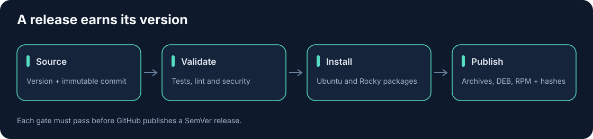

.. SPDX-FileCopyrightText: 2025 Thomas Vincent
.. SPDX-License-Identifier: Apache-2.0

Releases and migration
======================

``pyproject.toml`` holds the version. Release Please
(``.github/workflows/release-please.yml``, configured by
``release-please-config.json``) computes the next SemVer version from the
Conventional Commit titles merged since the last release, and its release pull
request bumps every other copy: ``uv.lock``, both Helm version fields, the chart
test, the Nomad job's default image and the installation guide. The container
image's ``org.opencontainers.image.version`` label and the documentation's
version are read from ``pyproject.toml`` at build time. A test fails when the
source version appears in a tracked file that Release Please does not update.

Merging the release pull request tags ``vX.Y.Z`` on that commit, creates the
GitHub release with the generated notes and calls the Release workflow with the
version. The Release workflow can also be run by hand on main for an existing
version; it checks that the version is complete SemVer matching the source,
that an existing tag identifies the checked-out commit and that the source
belongs to main. Pushing a tag by hand does not publish.

To rehearse the provenance check without publishing, run the Release workflow
by hand with ``dry-run`` set and the source version (any branch). It runs full
CI and builds and attests the artifacts like a release, then verifies the
attestations, but creates no tag, GitHub release or container tag.

The release pull request is opened with ``GITHUB_TOKEN`` unless the
``RELEASE_PLEASE_TOKEN`` secret holds a fine-grained token or GitHub App token
with contents and pull-request write access. GitHub does not start workflows
for pull requests opened with ``GITHUB_TOKEN``, so without that secret, close
and reopen the release pull request to run CI before merging it.

Publication reuses full CI, including native package builds and installation
on Ubuntu 24.04 and Rocky Linux 9. GitHub assets include the wheel, source
archive, Helm chart, Debian package, RPM, commit metadata and ``SHA256SUMS``.
Public assets receive GitHub build provenance attestations, which the
Release workflow verifies with ``scripts/verify_release_provenance.py`` before
it publishes them. The workflow always runs on main (Release Please calls it
from a push to main), so the attestations record ``refs/heads/main`` and the
built commit, not the tag; verification requires both, plus the Release
workflow as signer and a GitHub-hosted runner. GHCR images are
scanned, signed by immutable digest and promoted to the SemVer tag after checks;
prereleases do not replace the latest image tag. Build metadata maps ``+`` to
``_`` in container tags because OCI tags do not accept plus signs.

The separate ``Publish verified Python release`` workflow on main downloads
the matching GitHub release's wheel and source archive, verifies checksums and
the Release workflow's attestations with the same script, binding them to
``refs/heads/main`` at the commit the ``vX.Y.Z`` tag points to, then runs Twine
checks. A dry-run artifact built from another commit cannot pass. Dry-run
is the default and may validate a review branch. Uploads require main and
select the ``pypi`` or ``testpypi`` environment, and publish those verified
assets without rebuilding them through ``pypa/gh-action-pypi-publish`` with
`trusted publishing <https://docs.pypi.org/trusted-publishers/>`_: only the
upload job holds ``id-token: write``, and PyPI exchanges its OIDC token for a
short-lived upload token, so no API token is stored. The action also uploads
PEP 740 attestations for the wheel and source archive, alongside the GitHub
build provenance attestations from the Release workflow.

Until a maintainer enables it, an upload run fails before uploading and names
the missing setup. To enable a destination:

1. On https://pypi.org/manage/account/publishing/ (or the TestPyPI equivalent),
   add a pending trusted publisher with owner ``somethingwithproof``,
   repository ``nagios-plugins-collection``, workflow ``publish-release.yml``
   and environment ``pypi`` (``testpypi`` for TestPyPI). The first upload
   creates the project and turns the pending publisher into a normal one.
2. In the repository settings, add required reviewers to that environment and
   set its variable ``TRUSTED_PUBLISHING`` to ``true``.

Version 3.0 changes
-------------------

The public repository's ``MIGRATION.md`` lists the 3.0 changes to options,
exit codes, thresholds and output, and the steps to upgrade command
definitions.

Version 2.0 changes
-------------------

HTTP checks now verify certificates by default; use ``--ca-file`` for private
trust. The async command and HTTP utilities no longer accept timeout parameters:
wrap calls in ``asyncio.timeout(seconds)``. CLI deadlines remain supported and
HTTP requests also have a 30-second transport ceiling. HTTP SLI latency units
are milliseconds; website-status latency units are seconds. All failed probes
remain CRITICAL and cancellation reaps subprocess children.

All 21 entrypoints are exercised by native-package installation tests. Native
packages bundle Linux x86-64/Python 3.12 wheels and use OS libpq; the container
uses platform-specific runtime wheels. The public repository's ``MIGRATION.md``
provides the complete version-2 upgrade checklist.

Third-party clients retain their original notices. The runtime license audit
uses the locked shipping distributions and explicit named exceptions for the
existing Paramiko and Psycopg LGPL clients; development tools do not expand
the runtime distribution policy.
